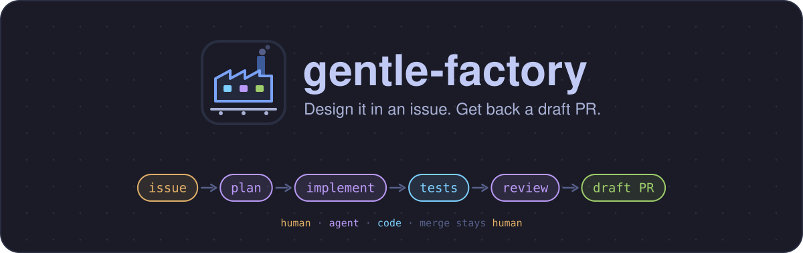
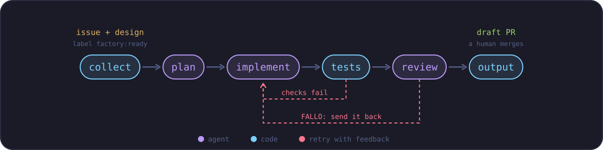

<p align="center">
  
</p>

<p align="center">
  <a href="LICENSE"></a>
  
  
  
  <a href="https://github.com/Gentleman-Programming/gentle-ai"></a>
</p>

<p align="center">
  <a href="#inspired-by-gentle-ai-as-autonomous-as-we-could-make-it">Why</a> ·
  <a href="#how-it-works">How it works</a> ·
  <a href="#quick-start">Quick start</a> ·
  <a href="#write-a-design">Write a design</a> ·
  <a href="#commands">Commands</a> ·
  <a href="#documentation">Docs</a>
</p>

---

> **Design it as an issue. The factory does the rest.**

**gentle-factory** turns a designed GitHub issue into a draft pull request, with no human in between.

The only thing you write is the design: a comment on the issue that says what to build, what is already decided, and which check proves it done. Then you add the `factory:ready` label. From there the factory works alone. It plans, implements, runs your checks, has a second agent review the change, and opens a **draft** PR. Merging is always yours.

It ships as one static Go binary with the pipeline built in. It knows nothing about your repository in advance. Everything it needs comes from the design and from the repository itself (`AGENTS.md`, `CLAUDE.md`, `CONTRIBUTING.md`, CI and scripts), read at run time.

## Inspired by gentle-ai, as autonomous as we could make it

[gentle-ai](https://github.com/Gentleman-Programming/gentle-ai) gives you an agent team that explores, plans, implements and verifies, with you in the conversation steering every step. gentle-factory asks a different question: **what if the conversation happened once, up front, in the issue?**

| | gentle-ai | gentle-factory |
|---|---|---|
| Where you work | In the conversation, with the agents | In the issue, before the run |
| Your input | Steering, approvals and answers along the way | One design comment and a label |
| When the agent is unsure | It asks you | It stops with `DECISION:` and waits for a better design |
| Output | Changes in your working tree | A draft PR, with receipts for every step |

So the design has to carry everything a conversation would have carried. That is the trade: more thinking before the run, no babysitting during it.

The pieces come from the same ecosystem. [Engram](https://github.com/Gentleman-Programming/engram), gentle-ai's persistent memory, is the planned shared memory between nodes, so that what the planner learns reaches the implementer and the reviewer, and what one run learns reaches the next. Today the nodes share state through files and receipts only; see the [roadmap](#roadmap).

## Why this project exists

This is my project to learn how software factories work by designing one. I wanted to understand what it takes for agents to deliver a change unattended: where human judgment cannot be skipped, what has to be checked mechanically rather than trusted, and how to stop a run before it burns budget on a guess.

The factory now builds itself: once the runner worked, new features were written as designed issues and handed to it. **14 of this repository's merged pull requests were opened by the factory** (the ones from `factory/<issue>` branches), each reviewed and merged by a human.

Every decision is written down: in the [architecture](docs/architecture.md), in the [design documents](docs/design/) and in this repository's issues. It is a working tool and a public notebook at the same time. Ideas, questions and criticism are welcome.

## Why it is built this way

| Principle | What it means in practice |
|---|---|
| **The harness closes a node, not the agent** | An agent saying "done" proves nothing. A node completes only when the runner has checked its guards and written a receipt ([in-toto](https://in-toto.io/) format). Runs can be resumed and audited. |
| **Red before green** | The design's `done_when` check must **fail** before any change, or the run never starts. A check that already passes proves nothing. |
| **Silence in the design means stop** | When the design does not cover a choice, the agent ends with `DECISION: <question>` and the run parks under `factory:needs-decision`. It never guesses. |
| **Bounded by design** | Edits are limited to the design's `expected_files`. Every node has a budget, a turn cap and a timeout, and the watcher pauses while draft PRs pile up. |
| **Humans hold both ends** | A human marks the design ready, and a human merges. The factory never merges anything. |

## How it works

<p align="center">
  
</p>

| Node | Kind | What it does |
|---|---|---|
| `collect` | code | Reads the issue, pins the design comment by hash, creates `factory/<issue>` and checks that `done_when` fails. |
| `plan` | agent, read-only | Plans the change against the design. |
| `implement` | agent | Edits and commits on `factory/<issue>`, only inside `expected_files`. |
| `tests` | code | Runs `done_when`. A failure goes back to `implement` with the output. |
| `review` | agent, read-only | A separate agent judges the change against the design and the repository's recent history. `FALLO:` sends it back. |
| `output` | code | Pushes the branch and opens a draft PR with each node's attempts, cost and duration. |

The same failure twice in a row stops the run instead of burning budget. Whatever the outcome, the factory reports back on the issue.

## Quick start

You need Go 1.22+, Git, an authenticated [`gh`](https://cli.github.com/) and [Claude Code](https://claude.com/claude-code) (`claude`).

```bash
go install github.com/FullFran/gentle-factory/cmd/factory@latest
```

Then pick how you want to run it:

```bash
# One issue, end to end: clone, run, archive the receipts, clean up
factory start OWNER/NAME#42

# Or keep watching repositories and start every issue labelled factory:ready
factory watch --repo OWNER/NAME --max-open-prs 3
```

> [!WARNING]
> The agents get edit and shell tools and act on issue content. Run the factory in a disposable machine or container, on issues you trust, with a GitHub token scoped to the watched repositories. See [Where it runs](docs/architecture.md#14-where-it-runs) and [deploy/](deploy/README.md) for a supervised setup.

## Write a design

A design is an issue comment: plain prose for the agents, plus a machine-readable block the factory validates. A minimal one:

````markdown
## Goal
`slugify` must turn "Hello, World!" into "hello-world".

## Decisions already taken
Lowercase only; drop punctuation; collapse runs of separators into one `-`.

<!-- factory-design:v1
{
  "schema_version": "1.0",
  "ready_signal": "factory:ready",
  "done_when": "go test ./internal/text -run TestSlugify",
  "expected_files": ["internal/text/slug.go", "internal/text/slug_test.go"]
}
-->

Rule on ambiguity: silence in this design means STOP. If an unexpected decision arises, end with `DECISION: <question>`.
````

Check it locally before you add the label (no network needed):

```bash
factory design check design.md --repo-dir /path/to/repo --issue 42
# DESIGN: status=VALID file=design.md expected_files=2 done_when=RED
```

The full format (budgets, caps, slices, gate levels) is in the [design comment template](docs/design/design-comment-template.md) and [its schema](schemas/design-comment.schema.json).

## Commands

| Command | Purpose |
|---|---|
| `factory design check` | Verify a design locally before `factory:ready`. |
| `factory start OWNER/NAME#N` | Run one issue end to end in a throwaway clone. |
| `factory watch` | Start `factory:ready` issues as they appear, with back-pressure on open draft PRs. |
| `factory collect` · `factory run` | The two halves of `start`, for running a custom spec by hand. |
| `factory report` | Comment the outcome on the issue and swap its labels. |
| `factory summary` · `factory status` | Cost, duration and outcome of past runs; the watcher's state. |
| `factory panel` | Local, read-only web UI over the receipts (loopback only by default). |
| `gates/prove-test.sh` | Prove a new test fails without the fix, in a disposable worktree. |

Every flag, exit code and file format: [docs/reference.md](docs/reference.md).

## Roadmap

- **Engram as shared memory** between nodes and across runs.
- **A risk node** that classifies the change and applies a consent policy before the PR ([#16](https://github.com/FullFran/gentle-factory/issues/16)).
- **More engines** per node (Codex, Pi, agy) next to Claude Code, and Orca to carry work between machines.
- **HCS packages** per node, run adapter and gate, so a factory becomes a composition you can rearrange.

## Documentation

| | |
|---|---|
| [Architecture](docs/architecture.md) | Flow, components, guards, lifecycles and decisions, with diagrams. |
| [Reference](docs/reference.md) | Commands, spec format, gates and pipeline in detail. |
| [Node contract](docs/design/node-contract.md) · [Receipts](docs/design/receipt-format.md) | What a node must produce and how it is recorded. |
| [Deploy](deploy/README.md) | Run the watcher as a supervised systemd user service. |
| [Catalog](catalog/README.md) | The [HCS](https://github.com/FullFran/hcs) catalog of the embedded pipeline. |

## Develop

The tests are self-contained shell scripts. They use `gh` and `claude` doubles, so they spend nothing:

```bash
bash tests/runner-test.sh     # the runner
bash tests/pipeline-test.sh   # the pipeline's code nodes
bash tests/start-test.sh      # start and watch against a local bare origin
```

Changes to `pipeline/` need `go run ./cmd/catalog build` so the catalog stays in sync.

## License

[Apache License 2.0](LICENSE).
