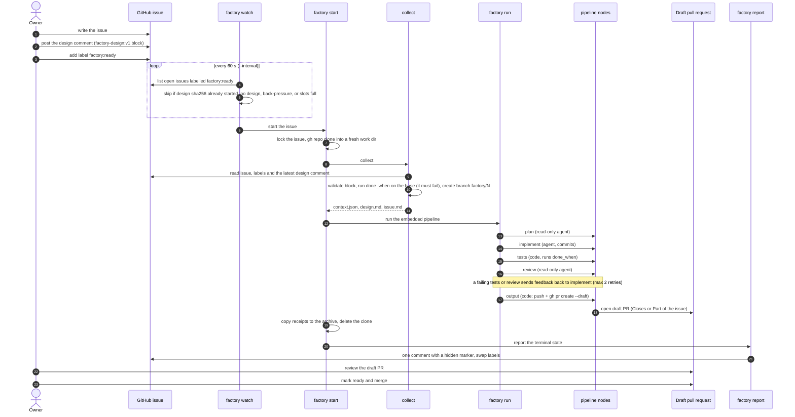
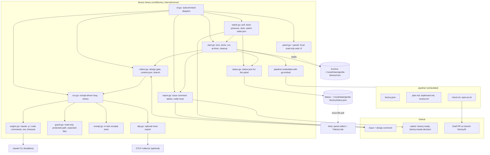
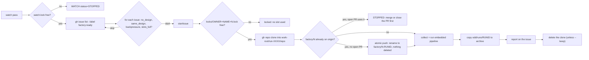
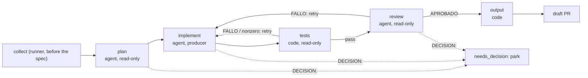
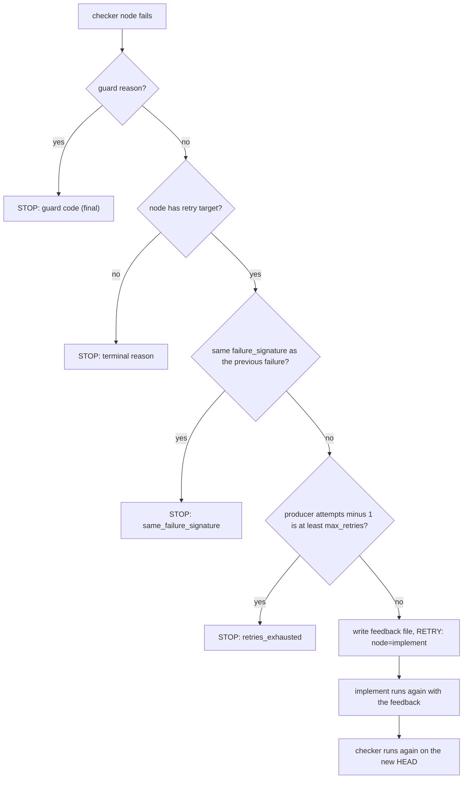
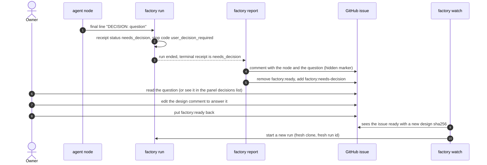
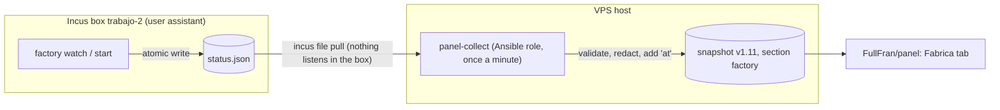
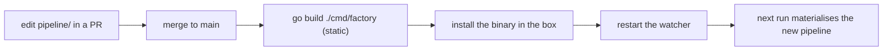
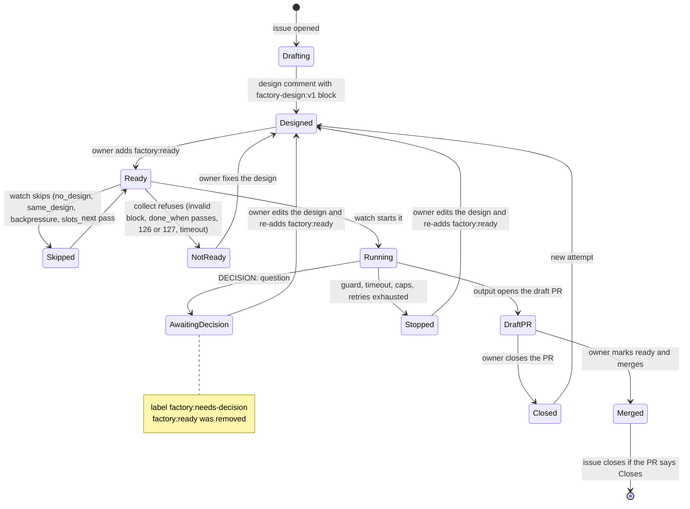
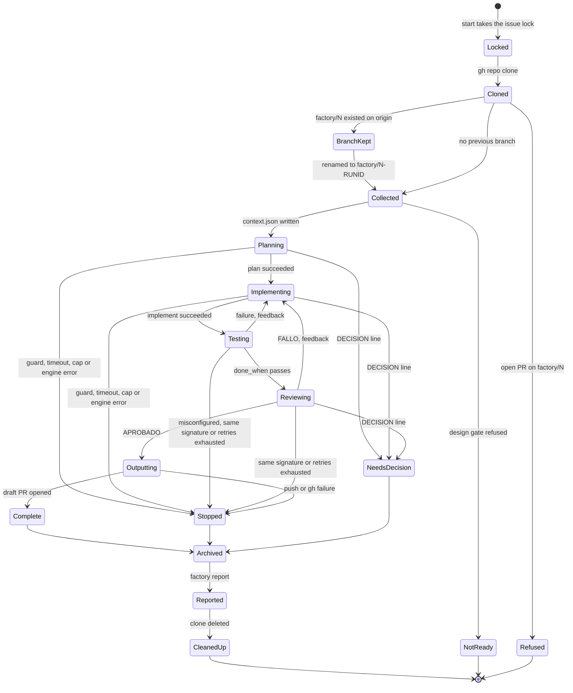

# gentle-factory architecture

This document explains how the factory works end to end: what runs, in what order, what it writes down, what stops it, and where it lives. It describes the code on `main`. Where a statement could not be checked in this repository (the workbox, other repositories, planned work) it is marked **Not verified in code** or **Planned**.

Contents:

1. [What the factory is](#1-what-the-factory-is)
2. [End-to-end flow](#2-end-to-end-flow)
3. [Components](#3-components)
4. [The binary and its subcommands](#4-the-binary-and-its-subcommands)
5. [The pipeline and its nodes](#5-the-pipeline-and-its-nodes)
6. [Guards, stop codes, retries and the receipt-driven flow](#6-guards-stop-codes-retries-and-the-receipt-driven-flow)
7. [Gates, budgets, caps and timeouts](#7-gates-budgets-caps-and-timeouts)
8. [Back-pressure and slots](#8-back-pressure-and-slots)
9. [The design comment contract](#9-the-design-comment-contract)
10. [The decision loop](#10-the-decision-loop)
11. [Slices: Part of versus Closes](#11-slices-part-of-versus-closes)
12. [Run artefacts and observability](#12-run-artefacts-and-observability)
13. [The status file and the panel](#13-the-status-file-and-the-panel)
14. [Where it runs: the workbox](#14-where-it-runs-the-workbox)
15. [Relation to HCS and the metaharness](#15-relation-to-hcs-and-the-metaharness)
16. [Lifecycles (state diagrams)](#16-lifecycles-state-diagrams)
17. [Glossary](#17-glossary)
18. [Where to look](#18-where-to-look)
19. [Known gaps and unverified points](#19-known-gaps-and-unverified-points)

---

## 1. What the factory is

gentle-factory is a software factory that turns a designed GitHub issue into a **draft pull request** without a human in the loop between the two. The human work is concentrated in one place, the *design comment* on the issue. When the owner adds the label `factory:ready`, a watcher picks the issue up, clones the repository into a throw-away directory, runs one fixed, repository-agnostic pipeline (`plan` -> `implement` -> `tests` -> `review` -> `output`) with Claude Code as the engine for the agent nodes, archives the receipts, deletes the clone, and reports the outcome back on the issue. Merging stays human. The factory is a harness plus input (a designed issue), output (a draft PR) and observability; it contains nothing specific to any repository (decision in [#1](https://github.com/FullFran/gentle-factory/issues/1)). It is one static Go binary, `factory`, built with the standard library only, and the pipeline it runs is embedded in that binary.

Two ideas drive the design:

- **The harness closes a node, not the agent.** An agent saying "done" proves nothing. A node is complete only when the runner has checked its guards and written a receipt for it ([node contract](design/node-contract.md)).
- **Silence in the design means stop.** If the design does not cover a choice that matters, the agent ends its answer with `DECISION: <question>` and the run parks until the owner answers ([design comment template](design/design-comment-template.md)).

## 2. End-to-end flow



If the run stops instead of completing, the same `Report` step comments the reason (or the `DECISION:` question) on the issue and removes `factory:ready`; see [section 10](#10-the-decision-loop).

## 3. Components



## 4. The binary and its subcommands

The CLI is `cmd/factory/main.go` calling `runner.Main` in `internal/runner/cli.go`. It has these subcommands (`factory --help` prints the same text):

| Subcommand | What it does | Exit codes |
|---|---|---|
| `collect --repo OWNER/NAME --issue N --checkout DIR --out DIR` | The design gate. Reads the issue with `gh`, requires the label `factory:ready` and a valid design comment, runs `done_when` on the base (it must fail), writes `context.json`, `design.md`, `issue.md`, and creates branch `factory/N`. | 0 ready, 1 `NOT_READY`, 2 misconfigured |
| `design check FILE [--repo-dir DIR] [--issue N]` | Verifies a design comment saved in a local file before `factory:ready`, without `gh`: the block checks of `collect`, the closing ambiguity line and, with `--repo-dir` (a clean checkout of the default branch, restored afterwards), that `done_when` fails (`DESIGN: check=done_when status=RED exit=N`). Last line `DESIGN: status=VALID file=FILE expected_files=K done_when=RED\|UNCHECKED` or `DESIGN: status=INVALID reason=...`. | 0 valid, 1 `INVALID`, 2 misconfigured |
| `run --spec SPEC --repo REPO --context CONTEXT [--run-id ID] [--runs-dir DIR]` | Runs the nodes of a spec against a target git repository. With `--run-id` it resumes. | 0 complete, 1 stopped, 2 invalid spec, context, arguments or repository |
| `start OWNER/NAME#N [--work-root DIR] [--archive DIR] [--spec FILE] [--keep]` | One issue, whole lifecycle: lock, clone, collect, run, archive receipts, report, delete the clone. | 0 complete, 1 stopped or not ready, 2 misconfigured |
| `watch --repo OWNER/NAME [--repo ...] [--interval S] [--slots N] [--max-open-prs N] [--once]` | Polls for `factory:ready` issues and starts them like `start`. | 0, or 1 when another watcher holds the lock, 2 on a failed `--once` pass |
| `report --runs-dir DIR --run-id ID --context FILE` | Derives the terminal state from the receipts and tells the owner (comment, labels, optional notify command). | 0, 2 on missing receipts or context |
| `summary [--repo REPO] [--runs-dir DIR] [--json]` | Per node: attempts, failures, decisions, retries, cost, duration, plus a `MOST:` line (which node fails, retries and costs the most). | 0 |
| `panel [--addr 127.0.0.1:8787] [--runs-dir DIR ...] [--spec FILE] [--allow-remote]` | A local, read-only web UI and JSON API over receipt stores. | 0, 2 on a non-loopback address without `--allow-remote` |

Machine-readable output lines are stable and are what tests and the other tools read: `NODE: ...`, `RETRY: ...`, `RUN: status=COMPLETE|STOPPED ...`, `START: status=... issue=... run=... archive=...`, `COLLECT: status=READY|NOT_READY ...`, `DESIGN: status=VALID|INVALID ...`, `REPORT: status=posted|already-posted ...`, `WATCH: ...`, `PANEL: url=...`.

Environment variables the binary reads:

| Variable | Effect |
|---|---|
| `FACTORY_CLAUDE_BIN` | Overrides the `claude` binary (tests use a double). |
| `FACTORY_GH_BIN` | Overrides `gh`. |
| `FACTORY_KILL_GRACE` | Seconds between SIGTERM and SIGKILL on a timeout (default 30). |
| `FACTORY_NOTIFY_CMD` | Optional command run once per report with a one-line message on stdin (split on spaces, no shell). |
| `OTEL_EXPORTER_OTLP_ENDPOINT` | Base URL; when set, `run` exports a trace at the end ([section 12](#12-run-artefacts-and-observability)). |
| `XDG_CACHE_HOME`, `XDG_DATA_HOME`, `XDG_STATE_HOME` | Move the work root, the archive and the status file. |

There is **no** `factory status` subcommand yet. The issue that asked for it ([#43](https://github.com/FullFran/gentle-factory/issues/43), slice 2) is still open, and `cli.go` dispatches only the eight commands above.

### How `start` and `watch` use the work root



Details that matter:

- Locks hold the owner's pid; a lock whose pid is dead is taken over. Two watchers, or two runs of one issue, cannot coexist.
- The sha256 of the design comment started for each issue is kept in `<work-root>/watch-state.json`. The same design never starts twice; an edited design starts again. A start that ends `MISCONFIGURED` is not recorded, so a broken environment is retried on the next pass.
- If the receipts cannot be archived, the clone is kept so they are not lost.
- The work root defaults to `${XDG_CACHE_HOME:-$HOME/.cache}/gentle-factory/work`; the archive to `${XDG_DATA_HOME:-$HOME/.local/share}/gentle-factory/runs`.
- A report failure is printed and never changes the run's outcome.

## 5. The pipeline and its nodes

The pipeline is `pipeline/factory.json` plus the prompts and scripts next to it. It is the same for every repository. Nodes run in order; the next node is the first without a current success receipt.



Spec-level settings: `factory: "issue-to-pr"`, `max_retries: 2`. `protected_paths` is not set in `factory.json`, so the default applies: `odd/runs/`, `.factory/`, `gates/`.

| Node | Kind | Role | Read-only | Inputs | Tools | Retry target | Caps (turns / USD / timeout) |
|---|---|---|---|---|---|---|---|
| `plan` | agent | producer | yes | - | Read, Grep, Glob, Bash | - | 25 / 1.5 / 1800 s |
| `implement` | agent | producer | no | `plan` | Read, Edit, Write, Grep, Glob, Bash | - | 50 / 4.0 / 1800 s |
| `tests` | code | checker | yes | - | `bash {spec_dir}/check.sh` | `implement` | timeout 900 s |
| `review` | agent | checker (read-only) | yes | `plan`, `implement` | Read, Grep, Glob, Bash | `implement` | 30 / 2.0 / 1800 s |
| `output` | code | checker | yes | - | `bash {spec_dir}/open-pr.sh {run_dir} {base_commit}` | - | timeout 300 s |

What each node does:

- **`collect`** is not in the spec; the runner does it first (`factory collect`, or inside `start`). It guarantees a ready, valid, *failing* starting point and pins the design (see [section 9](#9-the-design-comment-contract)).
- **`plan`** (`pipeline/plan.md`) learns the repository (`AGENTS.md`, `CLAUDE.md`, `CONTRIBUTING.md`, `README.md`, CI and scripts), may run the repository's own checks, and writes a plan of under 60 lines: root cause with `file:line` evidence, exact edits restricted to the expected files, the test to add first, the commands that prove `done_when`. It ends with `DECISION:` if the design is silent on something that matters. It is a **producer** with `read_only: true` on purpose: a producer receipt stays current when HEAD moves, so the planner does not re-run after every commit.
- **`implement`** (`pipeline/implement.md`) writes the failing test first, makes the smallest change, runs `done_when` and the plan's repository checks. A check that cannot start because a tool is missing (exit 126/127, "command not found", or status 77) is listed under "Not run here"; this never applies to `done_when`. It may commit but never pushes. Its final summary becomes the PR body. When a later node fails, the failure reason is appended to its prompt as feedback.
- **`tests`** (`pipeline/check.sh`, code) runs the design's `done_when` with `bash -c` and prints `FALLO: done_when failed: ...` on failure. With no `done_when` in the context it prints `FACTORY_GATES: status=MISCONFIGURED` and exits 2.
- **`review`** (`pipeline/review.md`) is a separate Claude session that did not write the change. It reads `git diff` against the base, learns what good means from the repository (instructions, CI, the last merged changes) and checks eight items: meets the design, test first, small and direct, fails loudly, no local details, follows conventions, docs follow behaviour, statements of fact are true. It ends with `APROBADO`, or `FALLO: <items>` (sent back to `implement`), or `DECISION: <question>` when the design itself is wrong.
- **`output`** (`pipeline/open-pr.sh`, code) requires branch `factory/<issue>` and at least one commit since the base, pushes it, and opens a **draft** PR with `gh pr create --draft`. It is idempotent: if an open PR for the branch exists it prints `PR: <url> (already open)`. The body contains `Closes #N` (or `Part of #N` for slices), the implementer's summary, the tail of the review, and a run-telemetry table (attempts, cost, duration per node, total cost). The PR title is the first non-`chore(factory):` commit subject.

How an agent node is launched (`internal/runner/engine.go`): `claude -p --output-format stream-json --verbose --max-turns N --max-budget-usd X --no-session-persistence [--model M] --allowedTools ... --disallowedTools ...`, with the prompt on stdin. The prompt is the node's markdown plus `## Issue`, `## Design` and, for each node in `inputs`, `## Output of <node>`. Always denied: `Bash(git push:*)`, `Bash(git tag:*)`, `Bash(git reset:*)`, `Bash(gh:*)`. A `read_only` node also loses `Edit`, `Write`, `NotebookEdit` and `Bash(git commit:*)`. Only engine `claude` is supported on agent nodes; other engines are future work and would run today as code nodes wrapping their CLI.

Every node gets these environment variables: `FACTORY_NAME`, `FACTORY_RUN_ID`, `FACTORY_TASK_ID` (default `OWNER/NAME#N`), `FACTORY_NODE_ID`, `FACTORY_ATTEMPT`, `FACTORY_CONTEXT_FILE`, `FACTORY_FEEDBACK_FILE`, a W3C `TRACEPARENT` (one trace per run), and `OTEL_RESOURCE_ATTRIBUTES` with `service.name=factory-<name>`, `factory.name`, `run.id`, `task.id` and `agent.engine` (`claude-code` or `code`).

Spec rules enforced at load (`internal/runner/spec.go`): unknown fields are rejected so a misspelt key cannot silently drop a guard; node ids match `[a-z0-9_-]+` and are unique; `inputs` and `retry` must name earlier nodes; a `retry` target must be a producer; `kind` is `code` or `agent`; `model` is allowed on agent nodes only and must match `^[A-Za-z0-9][A-Za-z0-9._\[\]:-]*$`. A `role` defaults to `checker` for code nodes and read-only agents, otherwise `producer`.

## 6. Guards, stop codes, retries and the receipt-driven flow

### Receipt-driven flow

There is no workflow engine and no separate state store (LangGraph was considered and rejected in [#1](https://github.com/FullFran/gentle-factory/issues/1)). The runner computes the next node from the receipts:

- A node is **current** if it has a success receipt and either it is a producer or the receipt's `head_commit` equals the present HEAD.
- So a **checker** receipt goes stale when HEAD moves (tests and review re-run after every new commit), while a **producer** receipt stays valid (plan is not repeated).
- Resuming a run (`--run-id`) re-reads the receipts and continues from the first node without a current success. A crashed node has no receipt and runs again.

### Guards (run before the receipt is written)

| Guard | Applies to | Trips when | Stop code |
|---|---|---|---|
| Read-only | nodes with `read_only: true` (including code nodes) | HEAD, `git status --porcelain`, the working diff or untracked files differ before/after | `read_only_modified` |
| Protected paths | every agent node | any file, symlink or directory under `odd/runs/`, `.factory/`, `gates/` (or the spec's `protected_paths`) or under the receipt store changed; read from the filesystem, so ignored files count | `protected_path_modified` |
| Expected files | producer agent nodes that succeeded | a path changed since the node began that no `expected_files` entry covers (exact path, glob, or `dir/**`) | `unexpected_path_modified` |

A guard trip is final. It is never retried, and resuming stops again (`guardReasons` in `run.go`). A new run also refuses a target with uncommitted changes (exit 2), so every commit comes from the run's own nodes. After a successful producer node the runner commits leftover edits itself as `chore(factory): <node> attempt <n> (<run_id>)`, so every receipt binds the exact commit it saw.

### Outcome of one attempt

For an agent node the last line of the result text decides: `FALLO: ...` is a failure (`step_failed`), `DECISION: ...` is `needs_decision` (`user_decision_required`). Otherwise the engine's result subtype maps to `completed`, `max_turns_exceeded`, `budget_exceeded` or `engine_error`; an unparsable stream is `engine_output_invalid`. For a code node: a last output line starting with `FALLO:` fails; a `FACTORY_GATES: status=MISCONFIGURED` verdict or exit 126/127 is `misconfigured` (no retry); a nonzero exit or a `RED` verdict fails (`gate_failed` when a verdict line is present, else `step_failed`); `GREEN` gives `gate_passed`. A step past its timeout gets SIGTERM, then SIGKILL after `FACTORY_KILL_GRACE` seconds, and fails with `timeout`; for agents the node log keeps the whole stream and the receipt notes name the turns and the last tool call.

### Stop codes

| Code | Meaning |
|---|---|
| `user_decision_required` | An agent ended with `DECISION:`. Status `needs_decision`. |
| `step_failed` | `FALLO:` or a nonzero exit without a gate verdict. |
| `gate_failed` | A gate verdict `RED`, or a nonzero exit with a verdict line. |
| `timeout` | Node exceeded `timeout_seconds`. |
| `max_turns_exceeded` / `budget_exceeded` | Engine hit `--max-turns` / `--max-budget-usd`. |
| `engine_error` / `engine_output_invalid` | Engine failed, or its output had no parsable `result`. |
| `misconfigured` | Missing prompt/context, `MISCONFIGURED` verdict, or exit 126/127. Not retried. |
| `read_only_modified`, `protected_path_modified`, `unexpected_path_modified` | A guard tripped. Final. |
| `same_failure_signature` | A checker failed twice in a row with the same `failure_signature`. |
| `retries_exhausted` | The producer already ran `max_retries` extra times. |
| `archive_failed` | Listed in the status schema; set when receipts could not be archived. |

### Return loop

When a node with `retry: <producer>` fails, its reason is written to `<run_dir>/feedback/<producer>.txt`, passed into the producer's prompt, and the producer runs again; the checker then re-runs on the new HEAD. The loop is bounded twice: by `max_retries` extra producer attempts (2 in the embedded spec, so at most 3 `implement` attempts) and by the **failure signature** (a sha256 of the failed check names, or of the normalised reason): two consecutive failures with the same signature stop the run.



## 7. Gates, budgets, caps and timeouts

**Gates.** A *gate* is a code check whose last line is `FACTORY_GATES: status=GREEN|RED|MISCONFIGURED`; `GATE: name=<n> status=...` lines before it are recorded in the receipt as `checks_passed` and `checks_failed` and feed the failure signature. The repository ships one gate, `gates/prove-test.sh`: given a base ref, it creates a detached worktree under `/tmp`, keeps HEAD's tests, restores non-test paths to the base, runs the test command there and requires it to fail with a declared failure code (`1` by default, `--fail-code N` repeatable). Its last line is `PROOF: status=PROVEN|NOT_PROVEN|MISCONFIGURED reason=...` with exit 0, 1, 2. It is repository-agnostic and covered by `tests/prove-test-test.sh`. **It is not a node of the embedded pipeline today**; the embedded `tests` node runs `done_when` through `check.sh`. The `gates/` directory is protected from agent edits.

**Caps in force.** They are per node, in the spec:

| Cap | Spec key | Default if omitted | How it is applied |
|---|---|---|---|
| Turns | `max_turns` | 30 | `claude --max-turns` |
| Budget | `max_budget_usd` | 3.0 | `claude --max-budget-usd` |
| Timeout | `timeout_seconds` | 1800 (agent), 600 (code) | SIGTERM then SIGKILL after `FACTORY_KILL_GRACE` (default 30 s) |
| Retries | `max_retries` (spec) | 2 | return loop |

The caps actually used are recorded in each receipt under `execution.caps`.

**Caps in the design comment: applied as ceilings.** The design block may carry `gate_level` (`light|standard|full`), `budget_cap_usd`, `turn_cap` and `timeout_seconds`. `collect` validates `gate_level` and the schema validates the types. `collect` copies the three caps into `context.json`, and `engine.go` applies them through `effectiveTurns`, `effectiveBudget` and `effectiveTimeout` (`spec.go`): for every node the effective cap is the smaller of the node's cap (or its default) and the design's cap, so a design can lower a cap but never raise it above the spec's. `budget_cap_usd` applies per agent node (passed as `--max-budget-usd` on each launch), not as a total for the run; `turn_cap` applies to agent nodes; `timeout_seconds` applies to agent and code nodes. The receipt records the caps that were enforced. `gate_level` is still not applied.

## 8. Back-pressure and slots

- **`--slots N`** (default 1): the number of issues `watch` starts in one pass. Runs are sequential, not concurrent. A start that finds the issue locked by another run neither consumes a slot nor counts as started.
- **`--max-open-prs N`** (default 3): while N open **draft** PRs from `factory/` branches wait for review in a repository, none of its issues starts (`WATCH: issue=... skip reason=backpressure`). The design is not recorded in `watch-state.json`, so the issue starts after a PR is merged or closed.
- **`--interval S`** (default 60): seconds between passes. `--once` does a single pass.
- **Skip reasons** printed by `watch`: `no_design`, `same_design`, `backpressure`, `slots_full`.

Not implemented: the deterministic consent policy and the `risk` node planned in [#16](https://github.com/FullFran/gentle-factory/issues/16) (a decision record of 2026-11-11 describes a `code` node running `gentle-ai review assess`; there is no such node in `pipeline/factory.json`), the author check on issue content, and aggregate spend alerts.

## 9. The design comment contract

The design is the only specification. It is a comment on the issue with a machine-readable HTML block followed by human-readable sections ([template](design/design-comment-template.md), [schema](../schemas/design-comment.schema.json)).

```text
<!-- factory-design:v1
{
  "schema_version": "1.0",
  "issue": 42,
  "ready_signal": "factory:ready",
  "done_when": "test -f tests/x.sh && bash tests/x.sh",
  "expected_files": ["src/feature.go", "tests/x.sh"],
  "gate_level": "standard",
  "slice": false
}
-->
```

| Field | Required | Rule |
|---|---|---|
| `schema_version` | yes | The string `"1.0"`. |
| `ready_signal` | yes | The string `"factory:ready"`. |
| `done_when` | yes | A non-blank shell command, run with `bash -c`. See below. |
| `expected_files` | yes | At least one entry. Normalised repo-relative paths or globs (`a/b.go`, `dir/*.sh`, `dir/**`). Rejected: absolute paths, `.` or `..` segments, `//`, and the protected prefixes `.factory/`, `.git/`, `odd/runs/`, `gates/`. A glob that happens to match a protected path still grants nothing: the protected-path guard wins. |
| `issue` | no | If present it must equal the issue number. |
| `gate_level` | no | `light`, `standard` or `full`. Validated, not applied. |
| `budget_cap_usd`, `turn_cap`, `timeout_seconds` | no | Validated by the schema. Applied as ceilings: each node uses the smaller of its own cap and the design's; never raises a cap. |
| `slice` | no | Boolean, default `false`. See [section 11](#11-slices-part-of-versus-closes). |

The block is strict: unknown fields are rejected (`additionalProperties: false`), so a misspelt key makes the issue `NOT_READY` instead of being ignored.

**`done_when` rules.** It must run without prompts, exit 0 on success, and **fail before the change**. `collect` runs it on the fresh branch with a 600 s limit and refuses the issue (`NOT_READY`) when it exits `0` (already passes, proves nothing), exits `126` or `127` (not executable or not found, proves nothing), or times out. The checkout is restored afterwards (`git checkout -- .` and `git clean`). A `done_when` that runs a test file the change will add must first test that it exists: `test -f tests/x.sh && bash tests/x.sh`. Because it is the node `tests` command too, it also gates the PR.

**Selection and pinning.** The latest comment on the issue containing a `factory-design:v1` block wins. `collect` records that comment's `id`, `url`, `sha256` (of the whole body) and `updated_at` in `context.json`, and every receipt carries those references. Editing the comment changes the sha256, which is also how `watch` knows the design changed. (The template document also describes aborting a running run when the hash drifts; **Not verified in code**: the runner records the reference but no node compares the live comment against it.)

**A design is self-contained.** Agent nodes read only the issue body and the design comment (written to `issue.md` and `design.md`). They cannot read other comments, linked issues or the network. Anything the change must quote has to be copied into the design.

**Collect refusals** are all `COLLECT: status=NOT_READY reason=...` with exit 1: missing label, no design comment, invalid block, issue mismatch, `done_when` problems. A branch `factory/N` that already exists locally, or a dirty checkout, is a configuration error (exit 2).

## 10. The decision loop

When the design is silent, the agent does not guess. The loop:



Rules that hold in code:

- A `needs_decision` receipt on the current HEAD stops the run again if you resume it; only a new design (a new run) moves on.
- The report comment is idempotent: it carries `<!-- factory-report:v1 run=ID receipt=N state=STATE -->`, where `N` is the position of the terminal receipt. Reporting the same terminal receipt twice posts nothing (`REPORT: status=already-posted`). A resumed run that ends again has a new terminal receipt and gets its own comment.
- `needs_decision` removes `factory:ready` and adds `factory:needs-decision` (created if missing); `complete` removes `factory:ready` and also removes `factory:needs-decision` when the issue carries it; `stopped` only removes `factory:ready`. That is why the owner must re-add the label: `watch` lists only labelled issues.
- The previous attempt's branch is never deleted. `start` renames an existing origin `factory/N` to `factory/N-<run_id>` in one atomic push (lease-protected) and starts again from a fresh `factory/N`. If an open PR uses `factory/N`, `start` refuses and changes nothing.
- The comment never contains receipts, logs, commands or absolute paths (paths in quoted text become `<path>`, text is capped), because target repositories can be public.
- Where the owner notices a parked decision: the local `factory panel` has a decisions view ordered oldest first (`GET /api/decisions`). `FACTORY_NOTIFY_CMD` is an optional hook and is left unset in the workbox per the decision record in [#15](https://github.com/FullFran/gentle-factory/issues/15).

## 11. Slices: Part of versus Closes

A design may declare `"slice": true` when it delivers only part of an issue. `collect` copies the value into `context.json`; `open-pr.sh` then starts the PR body with `Part of #N` instead of `Closes #N`, so merging that PR does not close the issue. Without it (or with `false`) the PR says `Closes #N`. The delivery-slicing research is in [docs/research/delivery-slicing.md](research/delivery-slicing.md).

## 12. Run artefacts and observability

### Where things are written

```text
<repo clone>/odd/runs/<run_id>/            (excluded via .git/info/exclude; never committed)
    receipts/0001-plan-1.json              one in-toto receipt per node attempt: NNNN-<node>-<attempt>.json
    logs/<node>-<attempt>.log              command line, stdout, stderr (agents: the whole stream-json)
    outputs/<node>.md                      the last successful answer of an agent node
    feedback/<node>.txt                    the reason that sent a producer back
```

`factory start` copies that directory to the **archive** (`${XDG_DATA_HOME:-$HOME/.local/share}/gentle-factory/runs/<run_id>`) whatever the outcome, then deletes the clone. Receipts are written atomically (temporary file, then rename) and are append-only. The run id looks like `run_<uuid-v4>`. `factory run` on its own writes to `<repo>/odd/runs` or `--runs-dir`.

### Receipts

A receipt is an [in-toto Statement v1](https://in-toto.io/Statement/v1) whose predicate follows [the receipt format](design/receipt-format.md) (schema: [receipt.schema.json](../schemas/receipt.schema.json)). Key rule: **reference, never copy**, so receipts hold issue numbers, comment hashes and commit SHAs rather than texts.

| Predicate field | Content |
|---|---|
| `version`, `run_id` | Format version (`0.1.0`) and run id. |
| `step` | `node_id`, `node_kind`, `attempt`. |
| `references` | `repository`, `issue` (number, url), `design_comment` (id, url, sha256, updated_at), `vcs` (`base_commit`, `head_commit`, `branch`). |
| `execution` | `engine` (`claude-code-headless` or the code command name), `engine_version`, `command`, `tools_allowed`, `caps` (`max_turns`, `max_budget_usd`, `timeout_seconds`). |
| `telemetry` | `trace_id`, `span_id`, `traceparent`, `gen_ai_system`, `request_model`, `tokens`, `total_cost_usd`, `num_turns`, `duration_ms`. |
| `outcome` | `status` (`success`, `failure`, `needs_decision`, `misconfigured`), `terminal_reason`, `exit_code`. |
| `gate` | For code nodes with a verdict: `status`, `verdict_line`, `checks_passed`, `checks_failed`. |
| `failure_signature` | sha256 on non-success, used by the return loop. |
| `notes` | The agent's last 2000 characters (or the failure reason first, prefixed `reason:`). |

**Tokens.** `telemetry.tokens` has `input_tokens`, `cache_read_input_tokens`, `cache_creation_input_tokens`, `output_tokens` and `total_tokens`. `input_tokens` is the *sum* of uncached input, cache reads and cache writes; the two cache fields break that sum apart so cache effects can be read (issue [#46](https://github.com/FullFran/gentle-factory/issues/46), closed). They are optional in the schema and come from the stream's `modelUsage`, with a fallback to top-level `usage`. `total_tokens = input_tokens + output_tokens`. Cost is the engine's `total_cost_usd`, which the reports call "list price".

### Report comments

`factory report` (called by `start`, or by hand) posts one comment per terminal receipt, as described in [section 10](#10-the-decision-loop). It states the state (`complete` with the draft PR link from the output node's `PR: <url>` line, `needs_decision`, or `stopped` with node, terminal reason and reason), attempts and total cost.

### OTLP export

With `OTEL_EXPORTER_OTLP_ENDPOINT` set (a base URL), `factory run` posts one OTLP/HTTP JSON trace to `<endpoint>/v1/traces` when it ends, whatever the status: a root span `invoke_workflow <factory>` and one `invoke_agent <node>` or `execute_tool <node>` span per attempt, carrying the receipt's span ids, tokens, cost and outcome (OpenTelemetry GenAI conventions). No prompts, outputs, commands or paths are exported. With the endpoint unset nothing is sent. A protocol other than `http/json` is skipped with `OTLP: export skipped: only http/json is supported`; a failure prints `OTLP: export failed: ...` and never changes the exit code. There is no retry, batching or header support. Issue [#13](https://github.com/FullFran/gentle-factory/issues/13) stays open for the real-collector proof (acceptance 4).

### Other tools over the same store

- `factory summary` aggregates the receipts of every run in a runs dir.
- `factory panel` (local, read-only) shows runs, an SVG graph of the spec with every attempt and retry, each attempt's receipt, output, log and feedback, and the decisions queue. API: `GET /api/runs`, `/api/runs/{dir}/{run_id}`, `/api/runs/{dir}/{run_id}/attempts/{node}/{attempt}`, `/api/decisions`. It binds loopback only (any other address exits 2 unless `--allow-remote`), never writes to a runs dir, and ships static HTML, CSS and JavaScript embedded in the binary. A running run with no file change for longer than the longest node timeout is flagged `silent`.

## 13. The status file and the panel

`start` and `watch` keep one small file for the host panel at `${XDG_STATE_HOME:-$HOME/.local/state}/gentle-factory/status.json` (file mode 0644, directory 0755). It is rewritten atomically when a watcher starts, on every pass, when a run starts, on every node transition and when a run ends. Each write starts from the previous file, so runs and day totals survive a watcher restart; an unreadable file is replaced. `factory run` alone, `report`, `summary` and `panel` never write it. A failed write prints `STATUS: write failed reason=...` and never changes a run.

Schema: [factory-status.schema.json](../schemas/factory-status.schema.json), `schema_version` `"1.0"`, every object closed and every string and array bounded.

| Section | Fields |
|---|---|
| top level | `schema_version`, `updated_at`, `watcher`, `current_run`, `last_runs`, `queue`, `today` |
| `watcher` | `started_at`, `last_pass_at`, `slots`, `slots_busy`, `repositories` (max 20) |
| `current_run` | `run_id`, `repository`, `issue`, `started_at`, `node_id`, `node_kind` (`agent`/`code`), `attempt` |
| `last_runs` (newest 20) | `run_id`, `repository`, `issue`, `started_at`, `finished_at`, `status` (`COMPLETE`/`STOPPED`), `stop_code`, `stop_detail` (max 200 chars, flattened and path-scrubbed), `total_cost_usd`, `duration_ms`, `retries`, `pr_number`, `request_model` |
| `queue` | per repository, the open `factory:ready` issue numbers (max 200); no titles |
| `today` | `date` (UTC), `runs`, `completed`, `stopped`, `total_cost_usd` |

`stop_code` is one of the stop codes in [section 6](#stop-codes) or `other`. The file never holds prompts, outputs, feedback, logs, tokens, issue titles or paths.



How the panel's Fábrica tab gets it, as described in the merged pull requests (read from GitHub, **not verified in this repository's code**):

- [FullFran/infra#168](https://github.com/FullFran/infra/pull/168) (merged) adds a `factory` section to the `panel-collect` snapshot (v1.11). Once a minute the host collector copies the file out of the box named by `panel_collect_factory_box` (set to `trabajo-2` in `vps.yml`) with `incus file pull`. The box pushes nothing and listens on nothing.
- The file is treated as untrusted: only a regular, non-symlink file of at most 256 KiB is read, from a fresh 0700 directory; `schema_version` must be `"1.0"`; only the schema's fields leave; malformed runs are dropped one by one; `stop_detail` is redacted. If the box has no file the section is `{"at": ..., "watcher": null}`; with no box configured, a symlink, an oversized or non-JSON file, or Incus down it is `null`.
- That change reaches production only through a manual Ansible apply of the `panel_collect` role on the VPS; whether it has been applied is **not verified**.
- [FullFran/panel#92](https://github.com/FullFran/panel/pull/92) (merged) makes the panel read the status file's own names (`current_run`, `last_runs`, `stop_code`, `pr_number`, queue as numbers) instead of earlier placeholder names, and drops queue titles.

The `factory panel` subcommand in this repository is a different, local tool over receipt stores; the Fábrica tab belongs to the separate FullFran/panel project and reads only the status file.

## 14. Where it runs: the workbox

Per the decision record in [#5](https://github.com/FullFran/gentle-factory/issues/5) (2026-11-11), the factory runs in a disposable work box from [FullFran/infra](https://github.com/FullFran/infra):

- Box: Incus container `trabajo-2` on the VPS, unix user `assistant`.
- Installed there: the `factory` binary (static build of `main`), the `claude-factory` agent profile (the factory must not use the owner's interactive config; the first run leaked the output style and global rules into a PR), and `~/work/start-factory.sh`.
- Credentials are what the user logs in with inside the box. The decision record asks for a fine-grained GitHub token limited to the watched repositories (contents, pull requests and issues write, short expiry), not the owner's general login.
- The box was set up as an authorised shortcut that skips the infra guards (egress allow-list [infra#45](https://github.com/FullFran/infra/issues/45), kill switch and caps [infra#49](https://github.com/FullFran/infra/issues/49)). Until those exist, the first runs are on trusted input only: issues and designs written by the owner in private repositories.

Operational facts supplied by the owner's brief and **not verifiable from this repository**: the start script `~/work/start-factory.sh` launches the watcher; the model is chosen with the `ANTHROPIC_MODEL` environment variable (the spec's per-node `model` key, if set, takes precedence via `--model`; the embedded spec sets none); logs go to `~/work/factory-logs`.

**Rebuild rule.** `pipeline/embed.go` embeds `factory.json`, `*.md` and `*.sh` with `//go:embed`, and `start` materialises them into a temporary directory per run. So the installed binary carries its own pipeline: **any change to `pipeline/` (spec, prompts or scripts) reaches the box only after rebuilding the binary and installing it there.** Editing files on the box does nothing. Passing `--spec FILE` overrides the embedded pipeline. This also means a binary and its pipeline cannot drift apart, and that `factory panel` draws the pipeline graph from the embedded spec by default.



Reaching the local panel of a box: keep the loopback bind and forward the port (`ssh -L 8787:127.0.0.1:8787 <box>`); never `--allow-remote`, because the panel has no authentication and logs carry machine paths.

## 15. Relation to HCS and the metaharness

- [HCS](https://github.com/FullFran/hcs) is the packaging spec the owner wants the factory built from: nodes, run adapters and gates as composable packages in a catalog. The [metaharness](https://github.com/FullFran/metaharness) composes catalogs with `--source <repo>` and keeps `factories/` as the generic place where factory repositories are listed.
- The README layout table lists `catalog/` ("generated HCS-0001 catalog") and `packages/`. **Neither directory exists on `main`**; today the factory ships as the Go binary with its embedded `pipeline/`, and the HCS packaging is direction, not current state. The runner does not read an HCS catalog.
- [#49](https://github.com/FullFran/gentle-factory/issues/49) (open, planned) is the first slice towards closing that gap: `go run ./cmd/catalog build` would generate `catalog/catalog.json` with one HCS-0001 entry for the embedded pipeline (content hash, size, content id, one contribution per embedded file), and `check` would exit 1 when `pipeline/` changes without a regenerated catalog. Later slices would validate in CI, add entries for gates, schemas and per-node packages with capability ids (HCS-0002), and consider signed catalogs (HCS-0007) and consuming metaharness entries. **Planned: `cmd/catalog` does not exist yet.**
- gentle-ai (the community toolkit the owner works with) is a source of pieces, not the engine: the plan is to wrap each piece behind a package that translates its output into a factory receipt. Today no gentle-ai piece runs inside the pipeline; the `risk` node in [#16](https://github.com/FullFran/gentle-factory/issues/16) would be the first (planned).
- Other engines (Codex, Pi, agy) and Orca as transport between nodes are not implemented. The runner starts each node as a subprocess on one machine and the decision record on [#2](https://github.com/FullFran/gentle-factory/issues/2) defers both until a node must run elsewhere.

## 16. Lifecycles (state diagrams)

### An issue



Note: when the merged PR said `Part of #N` (a slice), the issue stays open.

### A run



## 17. Glossary

| Term | Meaning |
|---|---|
| Node | One step of the pipeline: `agent` (a Claude Code session) or `code` (a deterministic command). |
| Producer / checker | A producer's receipt stays current while HEAD moves; a checker's goes stale when HEAD moves. Only a producer can be a `retry` target. |
| Receipt | The in-toto record of one node attempt. The only state the runner keeps. |
| Design comment | The issue comment with the `factory-design:v1` block; the only specification the agents get. |
| `done_when` | The design's shell command that proves the issue done; must fail on the base. |
| `expected_files` | The allowed edit surface; paths outside it trip `unexpected_path_modified`. |
| Guard | A check run before the receipt is written (read-only, protected paths, expected files). |
| Gate | A code check ending in `FACTORY_GATES: status=GREEN\|RED\|MISCONFIGURED`. |
| `FALLO:` | Last line meaning "this attempt failed"; the reason goes back to the producer. |
| `DECISION:` | Last line meaning "the design is silent"; parks the run. |
| `APROBADO` | The reviewer's approval line. |
| Failure signature | sha256 of the failed checks or normalised reason; two equal in a row stop the run. |
| Slot | One issue started per `watch` pass. |
| Back-pressure | No new runs while `--max-open-prs` factory draft PRs await review. |
| Slice | A design that delivers part of an issue; its PR says `Part of #N`. |
| Run | One execution of the pipeline for one issue, identified by `run_<uuid>`. |
| Archive | Where `start` keeps a run's receipts after the clone is deleted. |
| Workbox | The disposable Incus box (`trabajo-2`) where the factory runs. |
| Status file | `status.json`, the bounded view of the watcher for the host panel. |
| HCS | The packaging spec (catalogs, capabilities) the factory is meant to be assembled from. |
| Metaharness | The tool that composes HCS catalogs and lists factory repositories. |

## 18. Where to look

| Path | What it is |
|---|---|
| `cmd/factory/main.go` | Entry point; calls `runner.Main`. |
| `internal/runner/cli.go` | Subcommand dispatch, usage text, `summary`. |
| `internal/runner/collect.go` | Design gate: parse and validate the block, pin the comment, `done_when` must fail, create `factory/N`. |
| `internal/runner/design.go` | `design check`: the design gate on a local file, plus the ambiguity-line check. |
| `internal/runner/run.go` | The receipt-driven loop, retries, guard enforcement, producer commits. |
| `internal/runner/engine.go` | Agent and code execution, the `claude` command line, env, timeouts, outcome mapping, token accounting. |
| `internal/runner/guard.go` | Read-only, protected-path and expected-files checks; git helpers. |
| `internal/runner/spec.go` | Spec and context loading and validation; defaults. |
| `internal/runner/receipt.go` | Receipt structs and the append-only store. |
| `internal/runner/start.go` | Locks, clone, stale-branch rename, archive, cleanup. |
| `internal/runner/watch.go` | Polling, skip reasons, back-pressure, slots, `watch-state.json`. |
| `internal/runner/report.go` | Issue comment, hidden marker, label swap, notify hook. |
| `internal/runner/status.go` | The status file writer. |
| `internal/runner/otlp.go` | OTLP/HTTP JSON trace export. |
| `internal/runner/panel.go`, `internal/runner/panel/` | The local panel server and its static UI. |
| `pipeline/factory.json` | The pipeline spec. |
| `pipeline/plan.md`, `implement.md`, `review.md` | The agent prompts. |
| `pipeline/check.sh`, `open-pr.sh` | The `tests` and `output` code nodes. |
| `pipeline/embed.go` | `go:embed` of the pipeline and `Materialize`. |
| `gates/prove-test.sh` | Proof that a new test fails without the fix. |
| `schemas/` | JSON Schemas: design comment, receipt, status file, CloudEvents envelope. |
| `docs/design/node-contract.md` | Node kinds, caps, receipt-driven flow, human gates. |
| `docs/design/receipt-format.md` | Receipt format, examples, OTLP mapping. |
| `docs/design/design-comment-template.md` | The design comment spec and template. |
| `docs/research/delivery-slicing.md` | Research on slicing deliveries. |
| `tests/` | Deterministic tests: `runner-test.sh`, `pipeline-test.sh`, `start-test.sh`, `report-test.sh`, `panel-test.sh`, `prove-test-test.sh`, `schemas-test.sh`, `design-check-test.sh`, `watch-repos-test.sh`, plus `otlp-receiver/` and `jsonschema-subset.jq`. They use `claude` and `gh` doubles and spend nothing. |
| `deploy/` | Watcher deployment: `factory-watch.sh` launcher, `watched-repos.example.txt` (format of the `--repos-file` list; the real list is deployment configuration and not versioned here), `systemd/gentle-factory-watch.service` user unit (`Restart=always`) and an install doc. |
| `odd/tasks/` | Feature documents used while building the factory. |
| `.github/ISSUE_TEMPLATE/` | Templates for factory tasks, epics and bugs. |

## 19. Known gaps and unverified points

Gaps in the code today:

- Design-level `gate_level` is accepted but not applied.
- No `factory status` subcommand ([#43](https://github.com/FullFran/gentle-factory/issues/43) slice 2).
- No `risk` node, consent policy, or author check on issue content ([#16](https://github.com/FullFran/gentle-factory/issues/16)).
- No design-drift abort: the design hash is recorded, not re-checked mid-run.
- No `catalog/`, `packages/` or `cmd/catalog` ([#49](https://github.com/FullFran/gentle-factory/issues/49)).
- Only the `claude` engine on agent nodes; no Orca transport, no Engram in the pipeline.
- The stale-output reaper and stuck guard from node contract section 4.3 are not implemented (README: "Not yet").
- `human gate` is a node kind in the node-contract document, not in the runner; a human gate today is the `factory:ready` label and the draft PR.

Not verified here (depends on other repositories or on the box): the contents of `~/work/start-factory.sh`, the use of `ANTHROPIC_MODEL`, the log directory `~/work/factory-logs`, whether the infra change that pulls the status file has been applied on the VPS, and whether the Fábrica tab currently shows live data. The completed runs reported on issues (for example the report comments on [#13](https://github.com/FullFran/gentle-factory/issues/13), [#36](https://github.com/FullFran/gentle-factory/issues/36) and [#46](https://github.com/FullFran/gentle-factory/issues/46)) show the pipeline ending in draft PRs at roughly 0.8 to 1.7 USD and 5 attempts each, but this document did not re-run anything.
