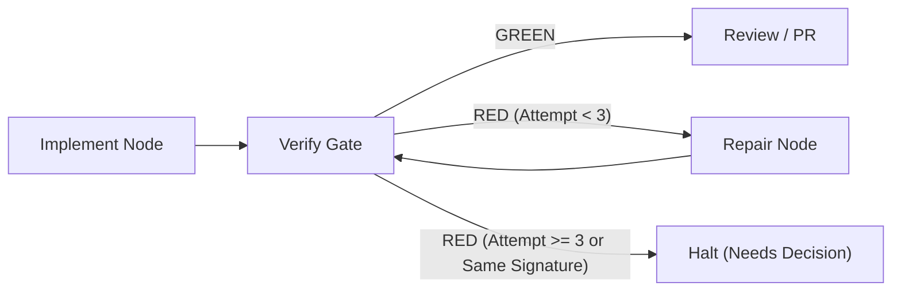

# Node Contract Specification (gentle-factory)

| Field | Value |
| --- | --- |
| Status | draft |
| Version | 0.1.0-draft |
| Date | 2026-11-10 |
| Context | S2 (`factory-v1-night.md`), gentle-factory#1 |
| Replaces | None |

---

## 1. Scope & Philosophy

This document defines the **Node Contract** for `gentle-factory`: the atomic, verifiable unit of execution in an autonomous software factory pipeline. It specifies the kinds of nodes, their input/output lifecycle, tool access policies, resource limits, and how a deterministic runner coordinates transitions purely from cryptographic execution receipts.

### 1.1 Architectural Principles

1. **"The harness closes a node, not the agent."**
   An agent’s self-reported "done" is never authoritative. A node completes only when the surrounding harness validates the produced artifacts, executes deterministic checks, and writes an immutable receipt.
2. **What would the Linux Foundation do?**
   Follow open, proven, vendor-neutral supply-chain standards:
   - In-toto attestation specifications for step outputs;
   - OpenTelemetry semantic conventions for AI execution telemetry;
   - CNCF CloudEvents for event dispatch;
   - Least-privilege role boundaries inspired by Unix process isolation.
3. **Receipt-driven flow (no external workflow graph engine).**
   State is not tracked in a secondary database or orchestrator checkpointer (such as LangGraph). The next node to execute is computed as a pure function over the chain of completion receipts.
4. **Default deny on design ambiguity.**
   When an agent encounters a design decision not covered by the human design comment, it must not guess or invent requirements. It halts and yields a `needs_decision` outcome.

---

## 2. Node Kinds

Every node in a gentle-factory pipeline belongs to exactly one of three fundamental kinds:

```
                    ┌────────────────────────┐
                    │       Node Kinds       │
                    └───────────┬────────────┘
         ┌──────────────────────┼──────────────────────┐
         ▼                      ▼                      ▼
┌──────────────────┐  ┌──────────────────┐  ┌──────────────────┐
│       code       │  │      agent       │  │    human gate    │
│  (deterministic) │  │  (generative LLM)│  │   (zero-token)   │
└──────────────────┘  └──────────────────┘  └──────────────────┘
```

### 2.1 Kind: `code` (Deterministic)

A `code` node executes deterministic logic without invoking an LLM.

- **Typical roles**:
  - Verification gates (`tests/*.sh`, `gates.sh`, linters, typecheckers);
  - Mutation / prove-test gates (reverting non-test changes to prove a new test fails on base);
  - Git branch preparation, tagging, worktree cleanup, and PR draft creation.
- **Characteristics**:
  - Zero token cost;
  - Predictable execution duration (milliseconds to minutes);
  - Deterministic exit codes: `0` for success (`GREEN`), non-zero for functional failure (`RED`) or misconfiguration (`MISCONFIGURED`).
- **Verdict Contract**:
  Gate scripts must terminate with a machine-parseable verdict line on stdout:
  ```text
  FACTORY_GATES: status=GREEN|RED|MISCONFIGURED [level=<level>] [passed=<N>] [failed=<M>]
  ```
  A gate that fails because dependencies are missing or an environment error occurred is `MISCONFIGURED`, never `RED` and never `GREEN`.

### 2.2 Kind: `agent` (Generative)

An `agent` node invokes an autonomous LLM runner to analyze, write, or refactor code.

- **Typical roles**:
  - Implementer (converts design comments into code, tests, and docs);
  - Repair worker (resolves defects identified by failing gate runs);
  - Independent reviewer (read-only adversarial evaluation).
- **Engine Support**:
  - **v1**: Claude Code headless CLI (`claude -p`).
  - **Planned**: Codex, Pi, Antigravity (`agy`).
- **Review Consent Automation**:
  When unattended review tools request approval, a deterministic policy in the runner answers it based on typed risk assessments:
  - *Medium or High risk*: Always granted (acts as the outside reviewer).
  - *Item 3 (Contract change)*: Granted, and flags the resulting draft PR with `contract-change`.
  - *Items 1 and 2 (Data mutation / Security)*: Granted, but halts execution prior to opening the PR and alerts the human operator.

### 2.3 Kind: `human gate` (Zero-Token Pause)

A `human gate` node suspends pipeline execution pending explicit human authorization.

- **Typical roles**:
  - Initial design approval: verifying an issue comment has been marked `factory:ready`;
  - Pre-merge sign-off: reviewing the generated draft PR;
  - Ambiguity escalation: answering an operator question when an agent halts on an unhandled edge case.
- **Characteristics**:
  - **Zero agent turns**: No LLM processes are spawned or polled while waiting;
  - **External event / poll driven**: The runner checks the GitHub API (or webhook feed) for authorized human signatures.

---

## 3. Inputs and Outputs Contract

Every node operates under an explicit inputs/outputs boundary.

### 3.1 Node Inputs

| Input Field | Source | Description |
|---|---|---|
| `workspace_path` | Runner | Absolute path to the isolated git worktree for this execution. |
| `issue_ref` | Runner | Target repository name and issue number (e.g., `FullFran/gentle-factory#1`). |
| `design_snapshot` | Issue | Frozen design comment identifier, last updated timestamp, and SHA-256 digest of comment body. |
| `upstream_receipts` | Receipt Store | Ordered list of all preceding verified receipts for the current run. |
| `parameters` | Factory Spec | Node-specific configuration (e.g. `gate_level`, `test_command`). |
| `credentials` | Runner Host | Scoped, least-privilege tokens. Read-only nodes must not receive write or push credentials. |

### 3.2 Node Outputs

| Output Field | Consumer | Description |
|---|---|---|
| `workspace_delta` | Git / Downstream | Committed changes in the working tree (commit SHAs). |
| `status` | Runner | Execution status: `success`, `failure`, `needs_decision`, or `misconfigured`. |
| `receipt` | Receipt Store | In-toto v1.0 Statement containing execution telemetry, gate verdict, and digest references. |
| `handshake` | Downstream Nodes | Ephemeral files or logs (e.g., test failure logs passed to a repair node). |

---

## 4. Engine, Tools, and Caps

### 4.1 Headless Engine Integration (v1: Claude Code)

For v1, agent nodes execute using Claude Code in non-interactive print mode:

```bash
claude -p \
  --max-turns <N> \
  --max-budget-usd <X> \
  --output-format json
```

The runner supplies the environment variable `TRACEPARENT` conforming to W3C Trace Context specifications, which Claude Code propagates into its execution traces.

The output JSON provides structured operational metrics:
- `terminal_reason`: String indicating why the session ended (`completed`, `max_turns_exceeded`, `budget_exceeded`, etc.);
- `total_cost_usd`: Accurate monetary cost accumulated during the run;
- `num_turns`: Number of conversational turns executed.

### 4.2 Tool Permissions and Role Isolation

To prevent prompt injection, test tampering, or unreviewed publication, nodes run with strict role-based tool restrictions:

| Node Role | Tool Grant | Restrictions & Denials |
|---|---|---|
| **Implementer** | `read`, `edit`, `write`, `bash` (restricted) | Cannot push to remote; cannot modify `.factory/`, gate scripts or the receipt store `odd/runs/` (`protected_files`). |
| **Reviewer** | `read`, `bash` (test readback only) | Hard denial on `edit`, `write`, `git commit`, `git push`. Credential-less worktree. |
| **Code Gate** | Deterministic runner | Executes only pre-declared test harnesses (`tests/*.sh`). No generative model access. |
| **Human Gate** | None | Pure runner checking API state. |

**Receipts are written by the runner only.** No agent node writes a receipt. After every agent node the runner diffs the node's changes and fails the node (`terminal_reason=protected_path_modified`) if any path under `odd/runs/`, `.factory/` or the gate scripts changed, before it writes that node's receipt. Protected paths win over a design comment's `expected_files`: listing them there does not grant access. This blocks forged or edited receipts from inside the worktree; signing receipts (in-toto DSSE) with a key agents cannot read is the later, stronger step.

### 4.3 Caps and Safety Guards

1. **Turn Cap (`--max-turns N`)**:
   Limits conversational iterations (default: 30 turns for implementation, 15 for repair). Prevents infinite reasoning loops.
2. **Budget Cap (`--max-budget-usd X`)**:
   Monetary guard per node attempt (default: $3.00 for implementation, $1.50 for repair).
3. **Outer Wall-Clock Timeout**:
   Because Claude Code lacks a native wall-clock timeout flag, the host runner enforces an external process deadline via `SIGTERM` followed by `SIGKILL` after 30 seconds (default: 30 minutes).
4. **Stale-Lap Reaper**:
   If an agent node emits no stdout/stderr or tool events for 30 consecutive minutes, the runner forcibly kills the process and marks the receipt as `failure` (`terminal_reason=stale_timeout`).
5. **Stuck Guard**:
   Detects if an agent executes the identical failing command or tool invocation 3 times sequentially without intervening edits. Trips and terminates early with `failure_signature` recorded.

---

## 5. Flow & Routing: Receipt-Driven Orchestration

### 5.1 Receipt-Driven Transition Logic

The runner does not rely on an external state machine or workflow database. The execution state of a factory run is computed solely from its accumulated receipts:

```text
Receipt Store (Receipt 1, Receipt 2, ...) ───► Runner Decide Function ───► Next Node
```

**Next Node Selection Algorithm**:
1. Load the factory pipeline definition (ordered sequence of nodes: e.g., `[design_gate, implement, verify, review, pr_draft]`).
2. Read all receipts associated with the active `run_id`.
3. Filter for receipts with `outcome.status == "success"` that are still current: for nodes that check code (`verify`, `review`, `pr_draft`), `references.vcs.head_commit` must equal the current head of the run branch (see §5.2). A checking receipt for an older commit is stale and does not count. Nodes that produce code (`implement`, `repair`) record the head they created and stay current after a later repair.
4. Identify the first node in the sequence that does not possess a current successful completion receipt.
5. If the previous node yielded `failure`:
   - If the node is `verify` and retry budget remains: schedule the `repair` node.
   - If the node is `repair` or retries are exhausted: transition to `needs_decision` (halt).
6. If all nodes have successful receipts: mark run as complete.

### 5.2 Idempotent Resume and Crash Recovery

- **Crash Invariance**: If a host machine restarts, a worker pod is evicted, or a runner crashes mid-step, **no completion receipt exists** for the active node.
- **Clean Resume**: When the runner resumes, it inspects the receipts. All completed nodes are skipped. The incomplete node is re-executed from scratch against the clean workspace baseline.
- **Never Run Twice**: A node with a current `success` receipt for that run is never re-executed.
- **Code changes invalidate downstream receipts**: a receipt is bound to the commit it observed (`references.vcs.head_commit`). When a later node moves the run branch head (for example a `repair` after `review`), every success receipt of a code-checking node for an older commit becomes stale, so `verify` and later checks run again against the new code. Producer receipts (`implement`, `repair`) are not invalidated: re-running them would discard the work under review. Receipts are never deleted; staleness is computed, so the history stays complete.

### 5.3 Bounded Repair Loop



1. **Attempt Bounds**: A failing verification gate permits at most **2 to 3 repair rounds** (configurable, default: 2).
2. **Identical-Failure Signature**:
   Every failure receipt must carry a `failure_signature` (enforced by the receipt schema): a deterministic hash of normalized error logs or failed check names.
   - If `attempt[N].failure_signature == attempt[N-1].failure_signature`: the repair agent failed to alter the defect. The runner halts immediately without burning further turns.

### 5.4 Global Back-Pressure

To prevent inundating human maintainers with unreviewed draft pull requests:
- **`STOP_IF` Backlog Threshold**: If more than 3 draft PRs generated by the factory are currently open and awaiting human review, the runner pauses ingestion of new issues.

---

## 6. Human Gate Protocol

A `human gate` node guarantees that human intent is strictly verified before execution commences or code is published.

### 6.1 Design Approval Gate (`design_gate`)

The first node in every gentle-factory run is the design gate.
1. **Ready Signal**:
   The human designer marks the GitHub issue with the label `factory:ready`.
2. **Integrity Pinning**:
   The runner locates the latest design comment adhering to the `<!-- factory-design:v1 ... -->` specification.
   - Computes `sha256(comment.body)`;
   - Records `design_comment.id`, `design_comment.updated_at`, and `sha256` in the node context.
3. **Execution Decision**:
   - If `factory:ready` is present and the comment validates against `schemas/design-comment.schema.json`: the gate emits a `success` receipt and execution proceeds to `implement`.
   - If the label is absent, or the comment fails schema validation: the gate remains in `waiting` (or returns `waiting` in polling loops).
4. **Invalidation on Mutation**:
   If a human edits the design comment after execution has begun, the SHA-256 digest changes. Subsequent nodes detecting this digest mismatch halt execution immediately.

### 6.2 Pre-PR Review & Escalation Gates

- When an agent encounters an unresolvable conflict or unspecified requirement, it emits `status="needs_decision"`.
- The runner posts the exact blocking question as a comment on the GitHub issue, notifies the Orca coordination queue, and opens an escalation gate.
- Resumption occurs only when an authorized human posts a reply containing the required directive and restores `factory:ready`.

---

## 7. External References & Verification Status

| Reference | Scope / Feature Cited | Verification Status | Citation / Evidence |
|---|---|---|---|
| **addyosmani/factory** | Gate script verdict format (`FACTORY_GATES: status=GREEN...`) | VERIFIED | `template/.claude/scripts/gates.sh:1-95` (repo commit `8af1165`) |
| **addyosmani/factory** | Back-pressure threshold (`STOP_IF > 3`) | VERIFIED | `CHARTER.md:146-152` |
| **Cole Medin (ai-software-factory)** | Stale lap reaper (30 min inactivity timeout) | VERIFIED | `DECISIONS.md:10-26` (repo commit `f6d8f69`) |
| **Cole Medin (ai-software-factory)** | Deterministic evidence-backed gates | VERIFIED | `DECISIONS.md:10-17` |
| **Cole Medin (Video 2)** | Transition defects dominate (21 of 23 failures in transitions) | VERIFIED | YouTube caption track at 08:09 (`youtu.be/YHKuUjicB3M`) |
| **owainlewis/machinist** | Read-only worker isolation, credential blanking | VERIFIED | `internal/managedworker/worker.go:264-266` (repo commit `4d7d776`) |
| **owainlewis/machinist** | Bounded repair rounds (cap of 3) | VERIFIED | `ARCHITECTURE.md` |
| **DoorDash agentic-orchestrator** | Harness-owned completion receipts | VERIFIED | `internal/agent/completion_protocol.go:14-40` (repo commit `ea4f920`) |
| **AWS ABCA** | Cedar hard-deny policies for read-only roles | VERIFIED | `agent/policies/hard_deny.cedar:15-37` (repo commit `c8fcdb0`) |
| **AWS ABCA** | Stuck guard on repeated tool failures | VERIFIED | `agent/src/stuck_guard.py:1-30` |
| **Claude Code Headless** | CLI flags `--max-turns`, `--max-budget-usd`, `--output-format json` | VERIFIED | Empirical test on 2026-11-10 recorded in gentle-factory#1 |
| **gentle-ai 4.4.0** | Non-interactive review consent `--consent granted` | VERIFIED | CLI test `gentle-ai review start --help` on 2026-11-10 |
| **in-toto Attestation Framework** | Statement v1.0 specification | VERIFIED | https://github.com/in-toto/attestation/blob/main/spec/v1.0/statement.md |
| **OpenTelemetry** | GenAI Semantic Conventions | VERIFIED | https://opentelemetry.io/docs/specs/semconv/gen-ai/ |
| **CNCF CloudEvents** | CloudEvents v1.0.2 specification | VERIFIED | https://github.com/cloudevents/spec/blob/v1.0.2/cloudevents/spec.md |
